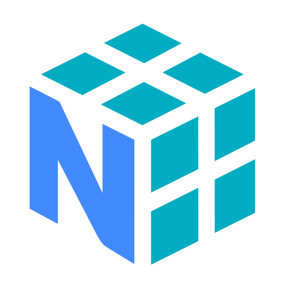
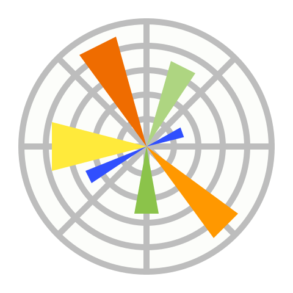
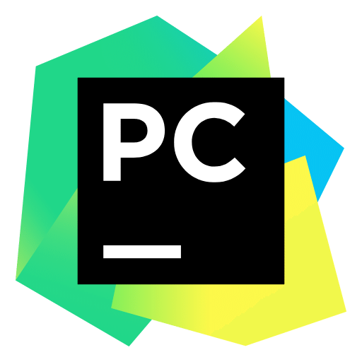
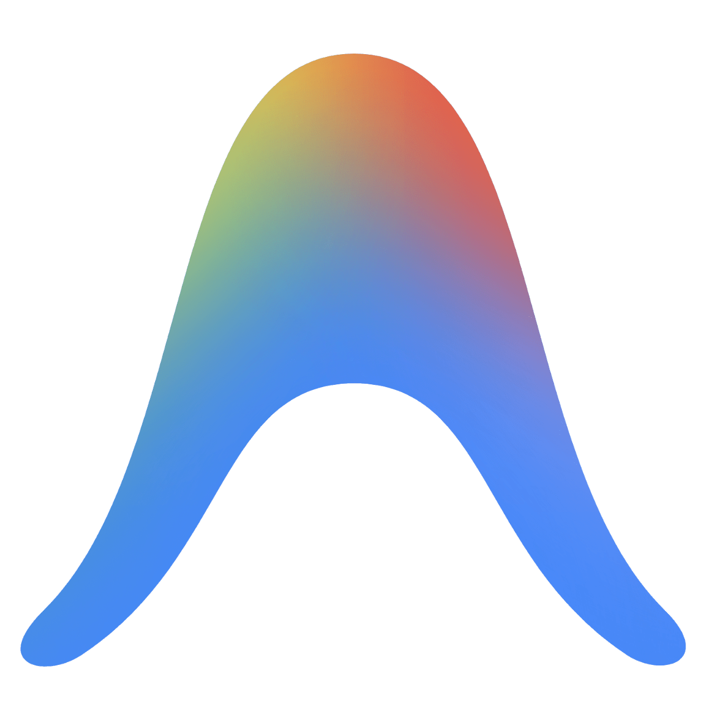
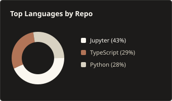
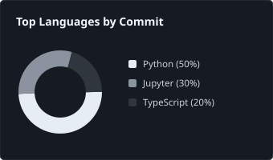
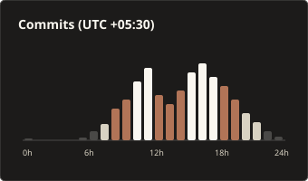
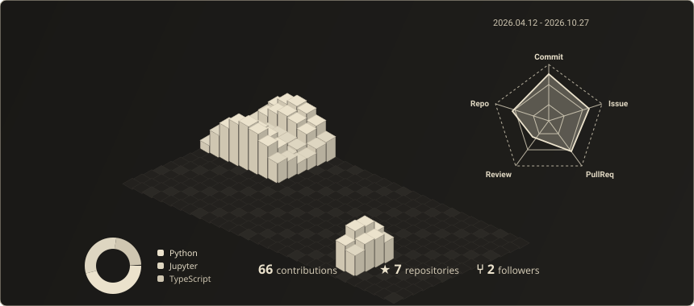

  

  &nbsp;&nbsp;
  &nbsp;&nbsp;
  

  <i>"In God we trust, all others must bring data."</i>

 

<!-- ==================================================================== -->
<!-- TECH STACK (IMAGE 2)                                                 -->
<!-- ==================================================================== -->
<h2 style="color:#FAF7F0;">💻 Tech Stack:</h2>

  <b style="color:#D8D2C2;">Languages:</b>&nbsp;&nbsp;&nbsp;
  &nbsp;&nbsp;
  &nbsp;&nbsp;
  &nbsp;&nbsp;
  &nbsp;&nbsp;
     

  <b style="color:#D8D2C2;">Libraries & Frameworks:</b>&nbsp;&nbsp;&nbsp;
  &nbsp;&nbsp;
  &nbsp;&nbsp;
  &nbsp;&nbsp;
  &nbsp;&nbsp;
  &nbsp;&nbsp;
  &nbsp;&nbsp;
  &nbsp;&nbsp;
  &nbsp;&nbsp;
  &nbsp;&nbsp;
  
     

  <b style="color:#D8D2C2;">Tools & Platforms:</b>&nbsp;&nbsp;&nbsp;
  &nbsp;&nbsp;
  &nbsp;&nbsp;
  &nbsp;&nbsp;
  &nbsp;&nbsp;
  &nbsp;&nbsp;
  &nbsp;&nbsp;
  &nbsp;&nbsp;
  &nbsp;&nbsp;
  &nbsp;&nbsp;
  &nbsp;&nbsp;
  &nbsp;&nbsp;
  &nbsp;&nbsp;
  &nbsp;&nbsp;
     

  &nbsp;&nbsp;&nbsp;<b style="color:#D8D2C2;">Databases :</b>&nbsp;&nbsp;&nbsp;
  &nbsp;&nbsp;
  &nbsp;&nbsp;
  

 

 

<!-- ==================================================================== -->
<!-- GITHUB ANALYTICS & STATS (IMAGE 1)                                   -->
<!-- ==================================================================== -->
<h2 style="color:#FAF7F0;">📊 GitHub Analytics & Activity:</h2>

<!-- 1. Streak Stats -->

  

<!-- 2. Profile Summary Cards -->

  
  
  

  

<!-- 3. Contribution Snake Grid -->

  

  

<!-- 4. 3D Isometric Contribution Graph -->

  

<!-- 5. Random Dev Quote -->
<h3 style="color:#FAF7F0;">✍️ Random Dev Quote</h3>

  

 

 

  &nbsp;&nbsp;
  

